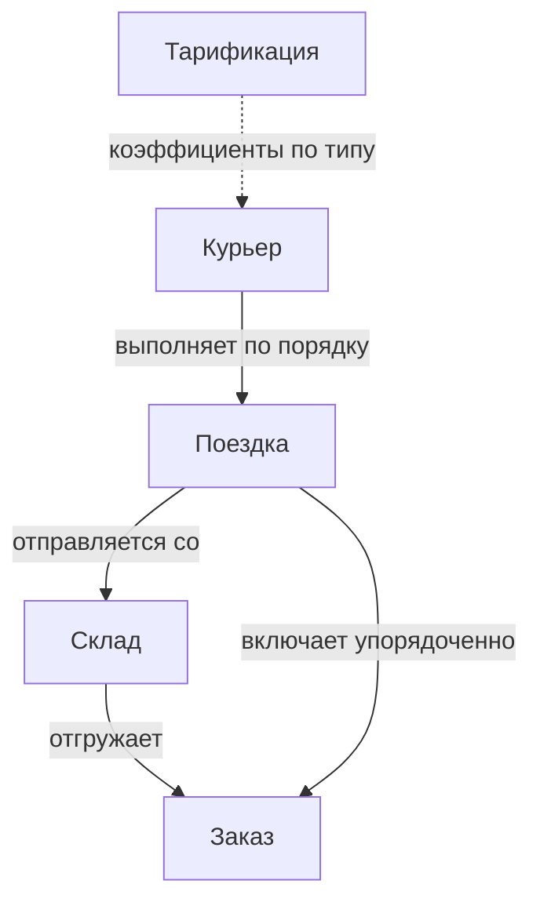

# Входные и выходные данные

## Связи между сущностями

Каждый заказ закреплён за одним складом и входит ровно в одну поездку; все заказы поездки — с одного склада. Поездку выполняет один курьер, курьер может выполнить несколько поездок подряд.

## Потоки данных

Исходные данные загружаются в хранилище, по запуску проходят преобразование и алгоритмический модуль и возвращаются в виде плана доставки, который сохраняется и отображается пользователю.

## Входные данные

### Заказ (`Order`)

| Атрибут | Поле | Обозначение | Описание | Единицы / значения |
| --- | --- | --- | --- | --- |
| Идентификатор | `id` | — | Уникальный номер заказа | — |
| Адрес доставки | `address` | \(\ell_a\) | Географические координаты точки доставки | долгота, широта (lon/lat) |
| Склад | `warehouse_id` | \(f(a)\) | Склад, за которым закреплён заказ | — |
| Масса | `weight` | \(w_a\) | Масса заказа | кг |
| Время готовности | `pick_up_ready_time` | \(r_a\) | Момент, с которого заказ готов к отгрузке | мин |
| Срок доставки | `deadline` | \(d_a\) | Момент, до которого заказ должен быть доставлен | мин |
| Курьер | `courier_id` | — | Курьер, которому назначен заказ, если он уже назначен | — |
| Статус | `status` | — | Текущее состояние заказа | new / queued / assigned / picked_up / delivered |

### Курьер (`Courier`)

| Атрибут | Поле | Обозначение | Описание | Единицы / значения |
| --- | --- | --- | --- | --- |
| Идентификатор | `id` | — | Уникальный номер курьера | — |
| Категория | `courier_type` | — | Источник курьера: курьер на смене, внутренняя биржа или внешняя служба доставки | on_shift / exchange / 3PL |
| Тип транспорта | `transport_type` | \(s_k\) | Способ передвижения курьера | feet / bike / car |
| Вместимость | `capacity` | \(M_k\) | Максимальная масса заказов в одной поездке; определяется типом транспорта | кг |
| Скорость | `speed_kmh` | \(v_k\) | Условная скорость; определяется типом транспорта | км/ч |
| Начальная позиция | `start_position` | \(p_k\) | Координаты курьера в начале смены | lon/lat |
| Текущая позиция | `current_position` | — | Координаты курьера на момент расчёта; от неё строится план | lon/lat |
| Статус | `status` | — | Текущее состояние курьера | inactive / going_to_shop / at_shop / delivering / handoff |

!!! info "Скорость"
    Скорость — условный показатель. Время перемещения между точками Система получает от методов расчёта времени в пути, в которых скорость учитывается неявно.

### Склад (`Warehouse`)

| Атрибут | Поле | Обозначение | Описание | Единицы / значения |
| --- | --- | --- | --- | --- |
| Идентификатор | `id` | — | Уникальный номер склада | — |
| Адрес | `address` | \(\ell_w\) | Географические координаты склада | lon/lat |

### Тарификация (`Tariffication`)

Коэффициенты задаются для каждого типа транспорта.

| Атрибут | Обозначение | Описание |
| --- | --- | --- |
| Стоимость поездки | \(\tau^{trip}\) | Фиксированная плата за одну поездку |
| Стоимость километра | \(\alpha\) | Плата за один километр маршрута поездки |
| Стоимость килограмма | \(\beta\) | Плата за один килограмм заказов поездки |
| Стоимость заказа | \(\gamma\) | Плата за один заказ поездки |
| Стоимость задействования курьера | \(\tau^{shift}\) | Фиксированная плата за курьера, получившего хотя бы одну поездку |
| Штраф за опоздание | \(\pi\) | Плата за одну минуту доставки после срока |

Как коэффициенты складываются в стоимость — на странице [Бизнес-правила и модель стоимости](../requirements/business-rules.md#модель-стоимости).

### Ограничения (`Constraint`)

Параметры ограничений планирования. Состав уточняется.

## Данные на этапах планирования

Планирование проходит три этапа, и каждый следующий получает на вход результат предыдущего. Сначала **кластеризация** разбивает заказы на группы — получается набор вариантов разбиения. Затем **маршрутизация** для каждой группы определяет порядок доставки, и группа становится рейсом. В конце **назначение** распределяет рейсы по курьерам — получается итоговый план.

| Этап | Вход | Выход |
| --- | --- | --- |
| Кластеризация | `couriers`, `orders`, `warehouses` | `set[Clusterization]` — набор вариантов разбиения заказов. Вариант (`Clusterization`) — множество кластеров; кластер (`Cluster = Set[Order]`) — группа заказов одной поездки. При кластеризации учитывается вместимость типов транспорта: группе присваивается наименьший тип транспорта, вместимость которого достаточна для её массы |
| Маршрутизация | `set[Clusterization]` | `set[list[Trip]]` — те же варианты, где для каждого рейса известен порядок доставки. Рейс (`Trip`) — упорядоченный кластер. Порядок находится решением задачи коммивояжёра: перебором всех возможных порядков, сложность O(n!) |
| Назначение рейсов курьерам | `set[list[Trip]]` | `dict[Courier: list[Trip]]` — рейсы каждого курьера |

«Рейс» и «поездка» в документации обозначают одно и то же.

## Выходные данные

Результат — словарь `dict[Courier: list[Trip]]`: для каждого курьера упорядоченный список его рейсов.

### Рейс (`Trip`)

| Атрибут | Обозначение | Описание |
| --- | --- | --- |
| Склад | \(w_j\) | Склад, с которого отправляется рейс |
| Заказы | \(\Omega_j\) | Заказы рейса в порядке доставки |
| Курьер | \(x_{kj}\) | Курьер, выполняющий рейс |
| Плановое время отправления | \(t^{dep}_j\) | Расчётный момент выезда со склада |
| Плановые времена доставки | \(t^{arr}_a\) | Список расчётных моментов доставки — по одному на каждый заказ рейса, в порядке доставки |

Время отправления и время доставки — плановые значения; фактические могут отличаться из-за внешних обстоятельств.
