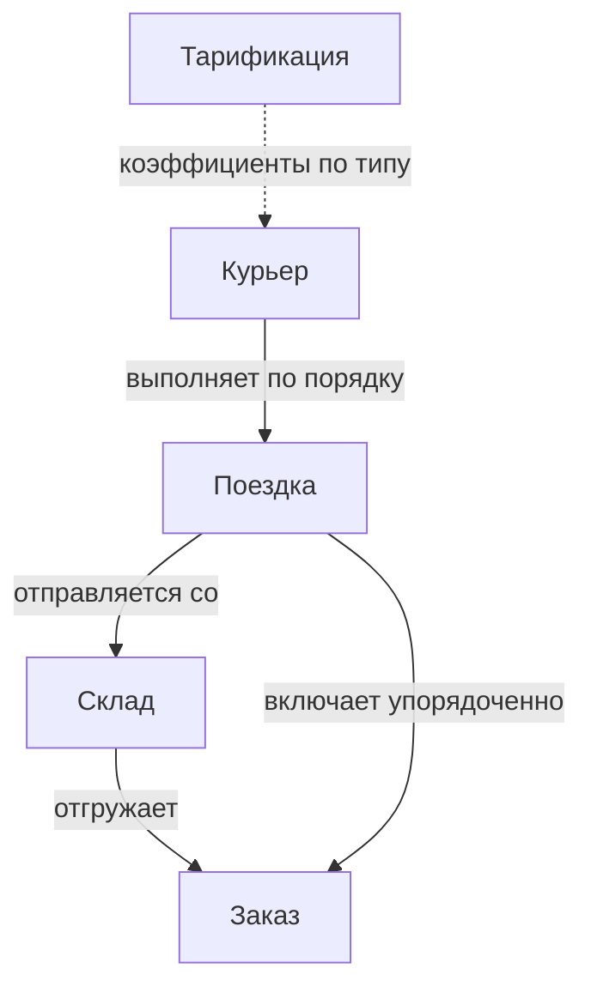
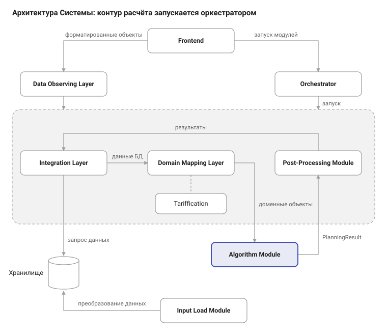

# Модель данных

## Связи между сущностями

Каждый заказ закреплён за одним складом и входит ровно в одну поездку; все заказы поездки — с одного склада. Поездку выполняет один курьер, курьер может выполнить несколько поездок подряд.

## Потоки данных

Исходные данные загружаются в хранилище, по запуску проходят преобразование и алгоритмический модуль и возвращаются в виде плана доставки, который сохраняется и отображается пользователю.

## Входные сущности

### Заказ (`orders: List[Order]`)

| Атрибут | Обозначение | Единицы | Описание |
| --- | --- | --- | --- |
| Координаты адреса | \(\ell_a\) | — | Точка доставки |
| Масса | \(w_a\) | кг | Учитывается при проверке вместимости и в стоимости поездки |
| Склад отгрузки | \(f(a)\) | — | Склад, за которым заранее закреплён заказ |
| Время готовности | \(r_a\) | — | Раньше этого момента поездка с заказом не отправляется |
| Срок доставки | \(d_a\) | — | После срока начисляется штраф за каждую минуту опоздания |

### Курьер (`couriers: List[Courier]`)

| Атрибут | Обозначение | Единицы | Описание |
| --- | --- | --- | --- |
| Тип | \(s_k\) | — | Пеший, велосипед или автомобиль |
| Скорость | \(v_k\) | — | Определяется типом |
| Вместимость | \(M_k\) | кг | Определяется типом |
| Начальная позиция | \(p_k\) | — | Где курьер находится на момент расчёта |

### Склад (`warehouses: List[Warehouse]`)

| Атрибут | Обозначение | Описание |
| --- | --- | --- |
| Координаты | \(\ell_w\) | Точка, откуда начинаются поездки |

### Тарификация (`tariffication: Tariffication`)

Коэффициенты задаются для каждого типа курьера.

| Атрибут | Обозначение | Описание |
| --- | --- | --- |
| Стоимость поездки | \(\tau^{trip}\) | Фиксированная плата за поездку |
| Стоимость километра | \(\alpha\) | По длине маршрута поездки |
| Стоимость килограмма | \(\beta\) | По массе заказов поездки |
| Стоимость заказа | \(\gamma\) | По количеству заказов поездки |
| Стоимость задействования курьера | \(\tau^{shift}\) | Если курьер получил хотя бы одну поездку |
| Штраф за опоздание | \(\pi\) | За каждую минуту после срока доставки |

Как коэффициенты складываются в стоимость — на странице [Бизнес-правила и модель стоимости](../requirements/business-rules.md#модель-стоимости).

### Ограничения (`constraints: Constraint`)

Параметры ограничений планирования. Состав уточняется.

## Результат планирования

### Поездка

| Атрибут | Обозначение | Описание |
| --- | --- | --- |
| Склад | \(w_j\) | Склад, с которого отправляется поездка |
| Заказы | \(\Omega_j\) | Упорядоченный список: порядок, в котором курьер их доставляет |
| Тип курьера | — | Тип, которому назначена поездка |
| Курьер | \(x_{kj}\) | Курьер, выполняющий поездку |
| Время отправления | \(t^{dep}_j\) | Не раньше готовности всех заказов и прибытия курьера на склад |

### Курьер в плане

| Атрибут | Обозначение | Описание |
| --- | --- | --- |
| Задействован | \(y_k\) | Получил ли курьер хотя бы одну поездку |
| Последовательность поездок | \(j_1, j_2, \dots\) | Порядок, в котором курьер выполняет свои поездки |

### Заказы, требующие дополнительных ресурсов

Список заказов, которые не могут быть доставлены курьерами на смене.

Результат сохраняется и отображается пользователю. Форматы и протоколы обмена с системами Заказчика необходимо согласовать.

!!! note "Нужно уточнение"
    - В каких единицах задаются скорость, координаты и время (готовности, срока)?
    - Как передаются заказы, уже распределённые по курьерам на момент расчёта (FR-9): отдельным атрибутом заказа или курьера?
    - Нужно ли выдавать в результате расчётное время прибытия по каждому заказу и итоговую стоимость плана?
